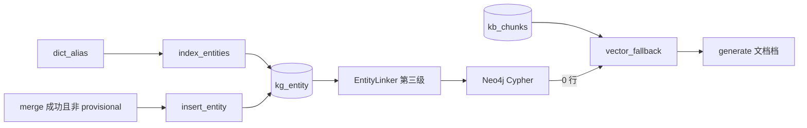

# Milvus 索引细节

> 实现在 `rag/client.py`、`rag/embed.py`、`scripts/index_entities.py`。图谱事实的过滤与遍历在 Neo4j，不在这里。Milvus 只回答两件事：这句话更像哪个已收录实体；图没有命中时，有没有足够像的文档块。

## 1. 部署与客户端

| 项 | 值 |
|---|---|
| 服务 | Milvus 2.4.17 standalone（`docker-compose.yml`） |
| 依赖 | etcd 3.5.16、MinIO |
| 地址 | `MILVUS_URI`，默认 `http://localhost:19530` |
| 鉴权 | `MILVUS_TOKEN`，空则客户端传 `None` |
| Python | `pymilvus` 3.x 的 `MilvusClient` |

代码不用已经废弃的 `connections.connect` + `Collection` ORM。`MilvusClient` 自己管理连接。进程内客户端懒加载，第一次插入或检索时创建。

健康检查不单独暴露 Milvus 端口语义；`GET /health` 会把向量库探活算进存储状态。Milvus 没启动时，实体向量兜底和文档降级都捕获异常并当成「没有命中」，`/chat` 仍返回弃答或纯图谱答案，而不是 500。

## 2. 两个集合

名称来自配置，默认不带模型版本后缀：

| 配置 | 默认集合名 | 用途 |
|---|---|---|
| `MILVUS_ENTITY_COLLECTION` | `kg_entity` | 实体链接的第三级 |
| `MILVUS_CHUNK_COLLECTION` | `kb_chunks` | 图谱 0 命中后的文档降级 |

`config.py` 的注释建议名称带 embedding 模型版本，避免换模型后维度对不上旧集合。当前默认值就是 `kg_entity` 和 `kb_chunks`。更换 `EMBEDDING_MODEL` 或 `EMBEDDING_DIM` 时要换集合名或清空重建，不能往旧集合里插另一种向量。

建集合函数 `_ensure_collection`：

```python
client.create_collection(
    collection_name=name,
    dimension=dim,          # EMBEDDING_DIM，默认 1024
    metric_type="COSINE",
    auto_id=True,
    description=desc,
)
index_params = client.prepare_index_params(
    field_name="vector",
    index_type="AUTOINDEX",
    metric_type="COSINE",
)
client.create_index(collection_name=name, index_params=index_params)
```

`has_collection` 为真则直接返回，不会修改已有索引或维度。集合一旦以错误维度创建，后面的插入会失败，需要换名或在 Attu / Milvus 里删掉重建。

`create_collection(dimension=...)` 是 MilvusClient 的快速建表：主键 `id`（Int64，`auto_id`）、向量字段 `vector`（FloatVector）。后续 `insert` 里多出来的标量（`canonical_id`、`label`、`name`、`text`、`doc_id`）靠客户端的动态字段落进去。代码没有手写 `CollectionSchema`，也没有为这些标量建索引。

检索按向量相似度取 top-k，再用 `output_fields` 把标量带回来。没有 `canonical_id == ...` 这种过滤下推。

## 3. 向量从哪来

`rag/embed.py`：

| 项 | 默认 |
|---|---|
| 模型 | `EMBEDDING_MODEL=text-embedding-v3` |
| 维度 | `EMBEDDING_DIM=1024`，与 `PGVECTOR_DIM` 相同 |
| 端点 | `DASHSCOPE_BASE_URL`，DashScope OpenAI 兼容模式 |
| 密钥 | `DASHSCOPE_API_KEY` |

必须设置 `check_embedding_ctx_length=False`。langchain-openai 0.3 默认会用 tiktoken 把输入切成 token id 再发送；DashScope 兼容端点只接受字符串或字符串数组，否则返回：

```text
400 InternalError.Algo.InvalidParameter:
Value error, contents is neither str nor list of str
```

实体文本是「标准名 + 全部别名」用空格拼接（`scripts/index_entities.py`）。文档块是调用方传入的原文，本仓库没有单独的切块入库脚本挂在启动流程里；`insert_chunk(doc_id, text, embedding)` 已实现，降级检索在集合为空或服务不可用时自然落到弃答。

## 4. 索引参数

| 项 | 取值 | 原因 |
|---|---|---|
| 字段 | `vector` | 唯一的向量列 |
| `index_type` | `AUTOINDEX` | 数据量是数百个实体加有限文档块，不做 HNSW 的 `M` / `efConstruction` 手工调参 |
| `metric_type` | `COSINE` | 与 embedding 的余弦语义一致；建集合时的 `metric_type` 和建索引时的必须相同 |
| 主键 | 自动 `id` | 业务键是动态字段 `canonical_id` 或 `doc_id`，不拿来做 Milvus 主键 |
| 标量索引 | 无 | 检索不按 id 过滤 |
| 搜索参数 | 未传 `nprobe` / `ef` | AUTOINDEX 由服务端选择 |

余弦度量下，`client.search` 返回的 `distance` 数值越大越相似（Milvus 对 COSINE 回的是相似度而不是「距离越小越好」）。业务代码把这个字段读成 `score`：

```python
"score": float(h.get("distance", 0.0))
```

阈值比较都是「大于等于」。若以后改成 L2，比较方向会反，实体链接和弃答会一起错，不能只改 `metric_type` 字符串。

代码没有设置 consistency level，沿用 MilvusClient 默认。索引脚本是离线批量写入，问答是之后才搜，不依赖写入后同一毫秒可见。

## 5. `kg_entity` 的写入与检索

### 5.1 一行的字段

`insert_entity` 插入：

| 字段 | 含义 |
|---|---|
| `vector` | 1024 维 |
| `canonical_id` | 图节点 id，如 `ING_00042` |
| `label` | `Ingredient` / `Nutrient` / `Population` / `Symptom` / `Taboo` |
| `name` | 该实体在别名表里按 `created_at` 出现的第一个别名 |
| `text` | 名称与全部别名拼接，只存储，检索 `output_fields` 不返回它 |

全量重建入口：

```bash
python -m scripts.index_entities            # 按 dict_alias 聚合后逐条 embed + insert
python -m scripts.index_entities --dry-run
python -m scripts.index_entities --limit 20
```

数据源是 `dict_alias`，按 `canonical_id` 聚合。provisional 节点只存在于 `kg_node_candidate`，不会出现在这张别名表里，因此全量脚本天然不会把单源未交叉验证的食材编进向量。

脚本注释写「先清空再写」。当前 `main()` 没有调用 drop 或 delete，重复执行会再插入一份相同 `canonical_id` 的向量（主键是 auto id）。重建前应在 Milvus 里丢掉 `kg_entity` 或先按业务键删除，否则 top-k 里会看到重复实体。

审核合并之后，`kg/promote.py` 对**非** provisional 的新食材再调一次 `insert_entity`。判断条件是节点候选 `props->>'provisional' == 'true'` 则跳过。这样单源食材只能经 Cypher、且带单源标记被引用，不能从向量兜底混进上下文。

### 5.2 检索怎么被用到

`graph/nodes.py` 的 `_entity_vector_search`：

1. `embed_query(原词)`
2. `search_entity(vec, top_k=3)`
3. 任何异常返回 `[]`

`search_entity` 的 `output_fields` 为 `canonical_id`、`label`、`name`。默认参数 `top_k=3`，与配置项 `ENTITY_LINK_TOP_K`（默认 5）不一致，调用点没有读该配置。

`EntityLinker.link` 仅在精确匹配和字级模糊（阈值 0.88）都失败后才调用向量。取首条，`score >= ENTITY_LINK_THRESHOLD`（默认 **0.82**）才算链接成功，`method` 记为 `vector`。阈值在 Python 里滤，不在 Milvus 的 range search 里滤，所以往返的是 top-3 全文结果。

整句最长匹配（`link_question`）不查 Milvus。向量只补「残片里抽出来、字典和模糊都对不上」的词。

## 6. `kb_chunks` 的写入与检索

`insert_chunk` 插入 `doc_id`、`text`、`vector`。集合描述是「文档块降级检索」。

`vector_fallback_node`：

1. 对**整句原问题**（不是归一化残片）做 embedding。
2. `search_chunks(vec, top_k=CHUNK_TOP_K)`，默认 top 6。
3. 丢掉 `score < CHUNK_THRESHOLD`（默认 **0.40**）的块。
4. Milvus 或 embedding 失败：`_vector_results=[]`，`_degraded=true`，并记下截断到 200 字的错误。生成节点据此弃答。

`output_fields` 为 `doc_id`、`text`。通过阈值的块在提示词里标成 `[文档/{doc_id}]`，系统提示要求模型说明这不是图谱结论，并禁止用常识补全。

0.40 比实体链接的 0.82 松，因为文档块是降级通道：太紧会把有限的文档也滤光，太松会把不相关段落交给模型。它仍然是硬阈值，低分原文不会进入提示词。

## 7. 和 pgvector 的分工

PostgreSQL `memory_fact.embedding` 也是 `vector(1024)`，迁移 `003_memory_vector.sql` 只建了 `user_id` 的 B-tree，没有 HNSW / IVFFlat。

| | Milvus `kg_entity` / `kb_chunks` | pgvector `memory_fact` |
|---|---|---|
| 内容 | 食材等实体；文档块 | 用户长期事实（设计如此） |
| 谁在问答里读 | 实体链接与降级检索 | 没有调用方 |
| 索引 | AUTOINDEX + COSINE | 无向量索引 |
| 过滤 | 无标量过滤 | 函数按 `user_id` 查出，未接入生成 |

换 embedding 模型时两边的 1024 维要一起换。只改 Milvus 集合、不改 `PGVECTOR_DIM`，记忆表以后一旦接入会对不齐。

## 8. 调用关系



向量命中不会绕过证据策略。它最多产生一个 `canonical_id`，后面仍要按意图跑 Cypher，由 `evidence_type`、过敏列表和 provisional 开关决定哪些边能进上下文。向量分数不会被当成证据等级。

## 9. 运维时核对的几件事

1. `python -m scripts.index_entities --dry-run` 看聚合出的实体数是否接近别名表的 `canonical_id` 去重结果。0 行说明 crosswalk 还没装进 `dict_alias`。
2. 问答里口语完全对不上、模糊也不像时，若 Milvus 为空，链接会停在未收录或弃答。这是预期，不是图查询写错。
3. 重复全量索引前先清空 `kg_entity`，避免同一食材占满 top-3。
4. 维度或模型变更：新建集合（改 `MILVUS_ENTITY_COLLECTION` / `MILVUS_CHUNK_COLLECTION`），再重新嵌入。旧集合的 AUTOINDEX 不会自动重算成新维度。
5. provisional 食材问句若只靠向量才链得上，链不上是故意的。应先通过多源审核、别名回流，再进 `dict_alias` 与 Milvus。
6. Attu 控制台（compose 未内置；部署环境若单独起了 Attu）里看集合的 `metric_type` 是否为 COSINE、维度是否为 1024。代码路径在集合已存在时不会纠正这两个值。
