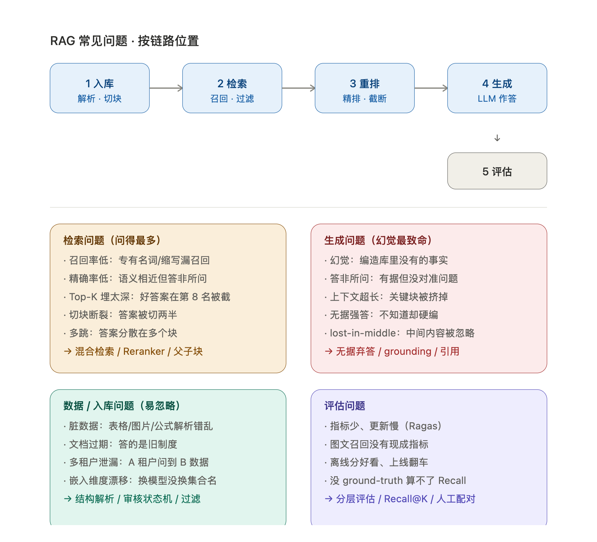

# RAG 常见问题与面试应对 · 结合 nutri_graph 项目

> 用途：面试准备。现在面试不只看「会不会用 RAG」，更看「碰到过什么问题、怎么定位、怎么解决、怎么防复发」。
> 本文分三层：① RAG 通用问题全景（按链路位置）；② 本项目真实踩过的坑（面试金矿）；③ 讲故事的标准框架。
> 另附「三·五 RAG 评测指标速查表」：除 Recall@K 之外的前 20 个成熟开源指标；「四·五 RAG 响应效率优化方案」；「四·六 RAG 上下文优化方案」。
> 更新：2026-11-01。

---

## 一、RAG 常见问题全景（按链路位置）

RAG 的坑基本分布在这五段：**入库 → 检索 → 重排 → 生成 → 评估**。

### 1. 检索阶段（面试问得最多）

| 问题 | 症状 | 根因 | 解法 |
|---|---|---|---|
| **召回率低（漏召回）** | 库里明明有的内容答不出、答非所问 | 语义向量对「专有名词 / 缩写 / 精确匹配」不敏感；切块把答案切碎了 | 混合检索（BM25 + 稠密）、同义词/别名扩展、父子块 |
| **精确率低（误召回）** | 答非所问、张冠李戴 | 向量召回「语义相近但答非所问」的块 | Reranker 重排、相似度阈值过滤 |
| **Top-K 埋太深** | 正确答案在第 8、9 名，被截断 | 只取 top-5/10，好答案在更后面 | 增大召回 K 再重排、用 MRR 评测定位 |
| **切块问题** | 答案被切两半、上下文断裂 | 固定长度切块不管语义边界 | 语义切分、标题链、父子块、重叠窗口 |
| **多跳问题** | 答案分散在多个块，单块凑不齐 | 单次检索只回一段 | 多轮检索、图检索、query 改写 |

### 2. 生成阶段（幻觉是核心）

| 问题 | 症状 | 根因 | 解法 |
|---|---|---|---|
| **幻觉（最致命）** | 一本正经编造库里没有的事实、瞎编数字/人名 | LLM 把「不知道」当「我知道」、无据强答 | 无据弃答/降级、引用 grounding、约束「只根据检索内容回答」 |
| **答非所问** | 有据但没对准问题 | 检索块对但理解偏 | 更好的 prompt、query 改写 |
| **上下文超长/丢失** | 检索块太多塞不下、或漏掉关键块 | token 窗口限制、拼接顺序乱 | 重排取前 N、压缩上下文、lost-in-middle 处理 |
| **lost-in-middle** | 模型忽略上下文中间部分 | 注意力对长上下文中段衰减 | 把关键块放首尾、或缩短上下文 |

### 3. 数据/入库阶段（容易被忽略但很致命）

| 问题 | 症状 | 根因 | 解法 |
|---|---|---|---|
| **脏数据、格式不统一** | 表格/图片/公式解析错乱 | 文档格式多样、版面复杂 | 结构感知解析（版面解析模型） |
| **文档更新/过期** | 答的是旧制度、旧价格 | 向量库没同步删除/更新 | 审核状态机、按 doc 删除向量 |
| **权限/多租户泄漏** | A 租户问到 B 租户的数据 | 检索没做隔离过滤 | `tenant_id` 过滤 |
| **嵌入模型版本漂移** | 新旧向量混在同一个集合里 | 换模型没换集合名 | 集合名带模型版本后缀 |

### 4. 评估阶段

- **评测标准不统一**：Ragas 指标少、更新慢，图文召回没有现成指标 → 沿用开源 Recall@K。
- **评测离线 vs 在线脱节**：离线分数好看、上线翻车 → 分层评估、只观察不干预。
- **评估没有 ground-truth**：图文 Recall@K 没有人工配对分母 → 人工构造正样本对。

---

## 二、本项目真实踩过的坑（面试金矿）

> 下面这些是 nutri_graph 项目实际发生并解决的问题。**面试时讲「我亲手踩过并修好的坑」远胜于背理论**，因为每个都证明了你在真实生产环境里处理过边界情况。

### 坑 1 · 导入「成功」但图里没有（静默丢数据，最值得讲）

- **现象**：图谱导入脚本报「成功」，但图查询搜不到这些节点。
- **定位**：对比 PG 候选表（标了 `merged`）和 Neo4j 实际节点数，发现 479 个对不上。
- **根因**：neo4j 驱动 auto-commit 写事务必须 `.consume()` 读完结果才真正提交；我没消费，会话结束时被 RESET 回滚了。而 PG 侧独立提交、照样标了 `merged`——**两个系统状态不一致，且全程无任何报错**。
- **修复**：补上 `.consume()`。
- **防复发**：加了一条「PG 候选数 vs 图节点数」的一致性校验脚本，导入后自动比对。
- **面试点**：双写不一致 + 无报错，本质是**分布式事务边界**问题。

#### 坑 1 详细拆解（没看懂就看这里）

**先理解三个前置概念：**

1. **Neo4j 的 `s.run()` 返回「惰性结果」**：这一行只是「把语句发出去」，还没真正执行完；要 `.consume()` 把结果读干净，auto-commit 写事务才真正提交。你不读，它就「悬着」。
2. **会话结束时驱动发 `RESET`**：`with driver.session() as s:` 这个块退出时，驱动自动发 `RESET` 清理会话，副作用是把「还没提交的写」**回滚掉**。
3. **项目里两个库各管各的**：Neo4j 存「图」，PG 存「候选表」记着「哪些该合并进图」。合并流程 = **先写 Neo4j、再写 PG**，两步、两个库、两次独立提交。

**Bug 发生过程（漏了 `.consume()`）：**

```
1. s.run("MERGE (n:食材...)")   ← 语句发出去了，但没读结果 → Neo4j 一直悬着没提交
2. （没有 .consume()，直接往下走）
3. 循环结束，with 块退出        ← 驱动发 RESET → 第 1 步那笔「没提交的写」被回滚 ✗
4. PG 标 merged                  ← PG 独立提交，照样把候选标成「已合并」 ✓
5. 结果：图里根本没有节点，PG 却写着「已合并」→ 两库不一致
```

**具体例子（3 个食材：苹果/香蕉/橙子）：**

| 步骤 | Neo4j（图） | PG（候选表） |
|---|---|---|
| 发 MERGE 苹果/香蕉/橙子 | 悬着，没提交 | 无变化 |
| 漏了 consume，直接往下 | 仍悬着 | 无变化 |
| with 退出，驱动发 RESET | ❌ 三个节点被回滚 | 无变化 |
| PG 标 merged | 图里空空的 | ✅ 三条都标 merged |
| **结果** | **图里 0 个节点** | **表里 3 条 merged** ❌ |

放大到真实场景：批量导入 1331 个食材，PG 全标 merged，图里只有 888 个节点。那 479 个「PG 说合并了、图里却没有」的食材，**用户查询时就是搜不到**——不是报错，是「本该有的就是查不出来」。

**为什么「无报错」最阴：** 两边都觉得自己成功了——Neo4j 的 `s.run()` 没抛异常（语句发出去了，只是结果没读），PG 的 `UPDATE` 正常提交，中间零报错、日志一片祥和。只能靠「对比两个库的数据量」才能发现（1331 ≠ 888，差 479）。

**面试怎么讲这段：** 不是看报错（没报错），而是对比两库数据量定位 → 根因是「Neo4j 惰性结果 + RESET 回滚」与「PG 独立提交」撞出双写不一致 → 修复补 `.consume()` → 防复发加一致性校验脚本。这段同时踩中「事务边界」「双写不一致」「静默失败」三个高级考点。

### 坑 2 · 测试删了生产数据（环境隔离问题）

- **现象**：跑测试时，生产 Neo4j 图被删了 120 个食材节点。
- **根因**：PG 能指到测试库，但 Neo4j 社区版只有一个库，测试与生产共用一张图；`rollback` 用 `provenance CONTAINS` 匹配，命中生产的 bundle。
- **修复**：`rollback` 改为精确匹配 `provenance = $bid OR STARTS WITH "$bid "`；`test_promote` 打 `graph` 标记，默认跳过，要跑必须显式 `ALLOW_GRAPH_TESTS=1`。
- **面试点**：**测试与生产共用数据源**的隔离设计；破坏性操作要有 guard。

### 坑 3 · 换镜像没装 vector 扩展，整批回滚（依赖缺失静默失败）

- **现象**：`init_pg` 整批回滚，0 张表。
- **根因**：`postgres:16-alpine` 镜像没有 `vector` 扩展，而建表脚本依赖它。
- **修复**：换 `pgvector/pgvector:pg16` 镜像，并由超级用户装扩展（pgvector 未标 trusted，业务角色 CREATE EXTENSION 报 InsufficientPrivilege）。
- **面试点**：**依赖缺失导致的静默失败**，以及扩展的权限边界（trusted vs superuser）。

### 坑 4 · `SET r.x = null` 等于删属性（null 语义陷阱）

- **现象**：往已有边写 amount/unit 时，把别的来源写好的营养边抹掉了。
- **根因**：Neo4j 里 `SET 属性 = null` 的语义是**删除属性**，不是「置空」。
- **修复**：拼 Cypher 时判空，空值不写这条 SET。
- **面试点**：**null 在特定系统里的隐式语义**，写库前要理解数据模型的空值约定。

### 坑 5 · 嵌入维度漂移（换模型静默混）

- **现象**：换 embedding 模型后，同一个集合里新旧向量混在一起，检索悄悄变差、不报错。
- **根因**：两个模型向量空间不同，但维度碰巧一样，混用不报错。
- **解法**：**集合名带模型版本后缀**（如 `xxx_model_version_dim`），启动时核对维度，不一致拒绝写入并提示重建命令。
- **面试点**：**版本漂移 + 静默降级**，用命名规范 + 启动校验兜底。

### 坑 6 · 前端强缓存 7 天（缓存失效）

- **现象**：改了 js/css，老用户浏览器 7 天内看不到更新。
- **根因**：`index.html` 是 no-store，但 `/assets/` 是 `expires 7d + Cache-Control: public` 强缓存。
- **修复**：改 js/css 后必须同步 bump `index.html` 里的 `?v=` 版本号。
- **面试点**：**静态资源的缓存策略**，no-store 与长缓存的边界。

### 坑 7 · Python 3.14 生态不兼容（依赖/版本管理）

- **现象**：`scikit-network` 无 cp314 轮子退回源码编译、缺 g++；`ragas 0.4.3 × langchain-community 0.4.2` 硬引用已删除的模块。
- **修复**：装 g++；就地打补丁（try/except + 占位类）。
- **面试点**：**版本兼容性管理**、离线补丁、镜像统一（pip 单一来源）。

---

## 三、讲故事的万能框架（STAR 变体）

每个问题都按这个五步讲，面试官会眼前一亮：

```
1. 现象：什么症状（用户/测试报了什么错、数据少了什么）
2. 定位：怎么排查的（日志、对比两个数据源、reload 确认）
3. 根因：到底哪里错了（一句话讲清技术本质）
4. 修复：改了什么（最小改动）
5. 防复发：加了什么机制（测试标记、guard、命名规范、文档、校验脚本）
```

### 示例（用坑 1「静默丢数据」完整讲一遍）

> **现象**：导入脚本报「成功」，但图查询搜不到这些节点。
> **定位**：对比 PG 候选表（标了 merged）和 Neo4j 实际节点数，发现 479 个对不上。
> **根因**：neo4j 驱动 auto-commit 写事务必须 `.consume()` 读完结果才真正提交，我没消费，会话结束时被 RESET 回滚了；而 PG 侧独立提交、照样标了 merged——两个系统状态不一致且无报错。
> **修复**：补上 `.consume()`。
> **防复发**：加了一条「PG 候选数 vs 图节点数」的一致性校验脚本，导入后自动比对。

这个「**双写不一致 + 无报错**」的坑，比任何理论都能证明你懂分布式一致性问题。

---

## 三·五、RAG 评测指标速查表（除 Recall@K 之外的前 20 个成熟开源指标）

> 面试常问「Ragas 指标少，你还会哪些评测指标」。这张表把主流指标按**四类体系**列全，并标出「本项目用不用、怎么用」。
> 分类：① 检索质量（传统 IR / RAG 专用）② 生成质量（忠实度/相关性/正确性）③ LLM 批判类 ④ 跨模态检索（图文，你项目特有）。出处均为开源实现（Ragas / DeepEval / TruLens / 传统 IR 库）。

### A. 检索质量（评估「检索器」这一环）

| # | 指标 | 定义 | 需要 ground-truth | 开源出处 | 本项目 |
|---|---|---|---|---|---|
| 1 | **Context Precision（上下文精确率）** | 召回的上下文中「真正有用」的比例；也看相关块是否排在前 | 是 | Ragas / DeepEval | ✅ 已在用（离线 Ragas 三项之一） |
| 2 | **Context Recall（上下文召回率）** | 回答所需的信息，上下文里覆盖了多少 | 是 | Ragas / DeepEval / TruLens | ✅ 已在用 |
| 3 | **Context Relevance / Contextual Relevancy** | 检索结果与 query 的整体相关性（噪声敏感） | 否 | DeepEval / TruLens | 可选 |
| 4 | **Hit Rate（命中率）** | 正确项是否出现在 top-K（布尔，比 Recall@K 更粗） | 是 | 自定义 / 各框架通用 | 等价 Recall@1 |
| 5 | **MRR（平均倒数排名）** | 第一个正确项排名的倒数均值，越低越差 | 是 | 传统 IR / tonic_validate | ✅ 已在用（配合 Recall@K） |
| 6 | **NDCG（归一化折损累计增益）** | 带位置权重的排序质量，考虑「多级相关」 | 是（分级相关） | 传统 IR / ranx | 可选 |
| 7 | **MAP（平均精度均值）** | 每个 query 的精度按召回位置平均 | 是 | 传统 IR / ranx | 可选 |
| 8 | **Precision@K** | top-K 里正确项占比 | 是 | 传统 IR | 可选 |

### B. 生成质量（评估「生成器」这一环）

| # | 指标 | 定义 | 需要 ground-truth | 开源出处 | 本项目 |
|---|---|---|---|---|---|
| 9 | **Faithfulness / Groundedness（忠实度/有据性）** | 答案是否完全由检索上下文支撑（衡量幻觉） | 否 | Ragas / DeepEval / TruLens | ✅ 已在用 |
| 10 | **Answer Relevancy（答案相关性）** | 答案是否直接回答了问题（不跑题） | 否 | Ragas / DeepEval / TruLens | ✅ 已在用 |
| 11 | **Answer Correctness（答案正确性）** | 与标准答案的事实一致性（事实分 + 语义分加权） | 是 | Ragas / DeepEval | 可选 |
| 12 | **Answer Semantic Similarity** | 答案与参考答案的嵌入语义相似度 | 是 | Ragas | 可选 |
| 13 | **Groundedness Score（证据支撑分）** | 逐句判定是否有证据、给事实分 | 是 | TruLens / UpTrain | 可选 |
| 14 | **Hallucination Score** | 检测答案中「无依据的断言」比例 | 是 | DeepEval / UpTrain | 可选（与 Faithfulness 重叠） |

### C. LLM 批判类（critique，二值 0/1 判定）

| # | 指标 | 定义 | 需要 ground-truth | 开源出处 | 本项目 |
|---|---|---|---|---|---|
| 15 | **Harmfulness** | 是否有有害/歧视/冒犯内容 | 否 | Ragas critique | 可选 |
| 16 | **Coherence（连贯性）** | 答案逻辑与结构是否通顺 | 否 | Ragas critique | 可选 |
| 17 | **Conciseness（简洁性）** | 是否简洁、无冗余 | 否 | Ragas critique | 可选 |
| 18 | **Maliciousness** | 是否有恶意意图/操纵 | 否 | Ragas critique | 可选 |

### D. 跨模态检索（图文互搜，你项目特有，Ragas 不覆盖）

| # | 指标 | 定义 | 需要 ground-truth | 开源出处 | 本项目 |
|---|---|---|---|---|---|
| 19 | **双向 Recall@K（R@1/R@5/R@10）** | 文本→图 / 图→文本 两个方向的正确项 top-K 命中率 | 是（人工配对） | CLIP_benchmark / open_clip | ✅ 已在用（你定的） |
| 20 | **跨模态 Mean/Median Rank** | 正确项的平均/中位排名，越低越好 | 是 | CLIP benchmark | 可选（配合 R@K 讲深度） |

### 一句话记忆（面试速答）

- **检索漏没漏** → Context Recall / Recall@K / Hit Rate；**检索准不准、排序对不对** → Context Precision / MRR / NDCG / MAP。
- **幻觉有没有** → Faithfulness（无据强答的照妖镜）；**答案对不对题** → Answer Relevancy；**事实对不对** → Answer Correctness。
- **图文召回** → 双向 Recall@K（Ragas 没有，跨模态检索的成熟协议）。
- **本项目落地**：离线 Ragas 三项（Faithfulness / Context Precision / Answer Relevancy，对应 9/1/10）+ 双向 Recall@K（对应 19），其余按需加。

---

## 四、高频面试追问（准备好回答）

1. **「你怎么知道召回是漏了还是误召回了？」** → 用 MRR/Recall@K 定位「埋得深不深」，区分漏召回（增大 K、加混合检索）和误召回（Reranker、阈值）。
2. **「幻觉怎么根治？」** → 没有「根治」，只有「抑制」：无据弃答、grounding 引用、约束 prompt、把检索质量做上去。诚实说边界比吹牛强。
3. **「为什么用混合检索而不是纯向量？」** → 专有名词/精确匹配是向量弱项，BM25 补稀疏侧，WeightedRanker 融合。
4. **「多租户怎么隔离？」** → 逻辑字段 `tenant_id` 过滤（demo 够用），演进到 partition/独立集合/独立实例，明确各档取舍。
5. **「评估怎么做才可信？」** → 分层：有据问答跑 Ragas，图文召回跑 Recall@K，人工配对做 ground-truth 分母，离线只观察不干预。
6. **「你的项目最有挑战的部分是什么？」** → 直接讲坑 1 或坑 2，讲「现象→定位→根因→修复→防复发」全链条。

---

## 四·五、RAG 响应效率优化方案（面试高频考点）

> 面试常问「RAG 慢怎么办、首字延迟怎么压、怎么省钱」。核心思路一句话：**响应耗时 = 检索耗时 + LLM 生成耗时 + 串行等待**，优化就是「并行、缓存、减量、换更快的模型」。按这三段拆开讲，每个方案都带「代价 / 权衡」。

### A. 检索阶段提速（压「检索耗时」）

| 方案 | 原理 | 代价 / 权衡 | 本项目适用 |
|---|---|---|---|
| **混合检索并行化** | 稠密 + BM25 两路**并行**发，再融合，不串行等 | 实现稍复杂；两路资源都要占用 | ✅ 可做（Milvus 已支持 hybrid） |
| **向量索引换 HNSW/IVF** | 用近似近邻索引替代暴力扫，检索从 O(N) 降到 O(log N) | 精度略降（ANN 有召回率损失） | ✅ 已是 AUTOINDEX，可换 HNSW |
| **降低 top-K / 减少召回量** | 召回从 50 降到 20、合成 6 条，减少排序与后续开销 | 可能漏召回（埋深的答案被截） | ✅ 你 plan 就是 20→6 |
| **提前过滤（tenant_id / 分区）** | 检索前先用标量过滤缩小子集，再在子集里查向量 | 过滤条件要能推给 Milvus | ✅ 你多租户方案 A 天然如此 |
| **嵌入缓存** | 相同 query 的向量缓存起来，避免重复调 embedding | 命中率取决于 query 重复度；要处理缓存一致性 | ✅ 食疗线已有 `cached_embedding` |
| **查询缓存（语义缓存）** | 相似 query 直接返回上次的答案，跳过整条链路 | 会命中过期答案；要设相似度阈值 + TTL | 可选（demo 可讲） |

### B. 生成阶段提速（压「LLM 生成耗时」+ 省钱）

| 方案 | 原理 | 代价 / 权衡 | 本项目适用 |
|---|---|---|---|
| **换更快/更小的模型** | 生成用 `qwen-turbo`/小模型，检索/评估才用大模型 | 答案质量可能下降；要分层用模型 | ✅ 你已有 `LLM_MODEL_POOL` 分层的底子 |
| **流式输出（streaming / SSE）** | 首 token 出来就推给前端，不等整段生成完 | 后端要改流式；总耗时不变但**体感**大幅提升 | ✅ 面试必提，最直观 |
| **减少上下文 token** | 只喂 top-N 相关块、压缩/摘要后再喂 | 压缩可能丢关键事实 | ✅ 你 top-6 已经是减量 |
| **约束输出长度** | `max_tokens`、让模型「简短回答」，减少生成 token | 答案可能不完整 | 可选 |
| **Prompt 缓存（KV-cache 复用）** | 系统提示词/固定前缀缓存，避免每次重算 | 依赖服务端支持（各家 API 不同） | 可选 |

### C. 系统级（压「串行等待」，通用）

| 方案 | 原理 | 代价 / 权衡 | 本项目适用 |
|---|---|---|---|
| **并行调用（多路召回 / 多步并行）** | 把无依赖的步骤并发，如检索和 query 改写并行 | 要梳理依赖关系 | ✅ 可做 |
| **连接池复用** | PG/Milvus 连接复用，避免每次建连 | 已有 `PG_POOL_SIZE` 那套，注意别把池打满 | ✅ 已有 |
| **异步 I/O（FastAPI async）** | 检索/嵌入这些 I/O 密集步骤走异步，不阻塞事件循环 | 要区分 CPU 密集（同步）与 I/O 密集（异步） | ✅ FastAPI 天然支持 |
| **批处理（离线批量嵌入/入库）** | 入库时批量 embed，而非逐条调用 | 只对离线入库有效，在线问答用不上 | ✅ 你 Phase B 入库适用 |
| **CDN / 静态缓存** | 图片、前端资源走 CDN，减轻应用压力 | 与响应「首字」无关，但整体体感更快 | ✅ 你 nginx 已有静态缓存策略 |

### 一句话记忆（面试速答）

- **检索慢** → 换 HNSW/ANN 索引、降 top-K、标量过滤先收窄、语义缓存。
- **生成慢 / 体感慢** → 流式输出（最直观）、换小模型、减上下文、限长。
- **系统慢** → 并行、异步、连接池复用、批处理。
- **省钱** → 模型分层（检索用便宜的、生成才用贵的）+ prompt 缓存。

### 面试讲法（把「优化」讲成「决策」）

别只背方案清单，讲成「**先定位瓶颈，再对症下药**」：

1. **先量**：用你项目现成的 trace（`span()` 落库，能看每个环节的耗时），定位慢在「检索」还是「生成」还是「串行等待」。
2. **再对症**：检索慢 → 索引/过滤/缓存；生成慢 → 流式/小模型/减上下文；都慢 → 并行/异步。
3. **讲权衡**：每个优化都有代价（ANN 损精度、语义缓存会过期、小模型降质量），说明你怎么在「速度 vs 质量」之间取舍——这比「我会用缓存」高级得多。

> 结合你项目：你已经有 `LLM_MODEL_POOL` 分层、`cached_embedding` 嵌入缓存、`tenant_id` 标量过滤、top-6 减量、FastAPI 异步、连接池——这些**现成的就能讲**，不用现编。

---

## 四·六、RAG 上下文优化方案（进阶考点）

> 面试问「检索结果太多/太少怎么办、token 超了怎么办、lost-in-middle 怎么破」——本质都在问**上下文优化**。
> 核心一句话：**上下文优化 = 三件事：少而精、压得短、排得对**。权衡永远是「token 成本 vs 证据完整」——塞少了幻觉、塞多了丢失，找平衡点就是工程能力。

### A. 检索侧优化（少而精，从源头控上下文质量）

| 方案 | 原理 | 本项目 |
|---|---|---|
| **Reranker 重排** | 检索出 20 条，再用 cross-encoder 精排取前 5，去掉「语义相近但无用」的块 | ⭐ 已列为演进项（性价比最高） |
| **相似度/分数阈值过滤** | 低于阈值的块直接丢弃，不进上下文 | 可做 |
| **去重**（按块 ID / 文本相似度） | 相似块只留一条，避免重复占窗口 | 可做 |
| **父子块检索** | 小块精准召回，但把整段「父块」喂模型，保证语义完整 | ⭐ 已提到，缓解切块碎 |

### B. 上下文压缩（把「长」变「短」）

| 方案 | 原理 | 代价 / 注意 |
|---|---|---|
| **LLM 摘要压缩（contextual compression）** | 用一个 LLM 把检索块「按当前问题」压缩成精简版，去掉无关句子 | 多一次 LLM 调用，但大幅省 token |
| **提取式压缩（Extractive）** | 用轻量模型/规则只抽「和问题最相关的句子」，不重写 | 比摘要快、便宜，可能丢连贯 |
| **RAG 专用压缩（LongLLMLingua）** | 靠困惑度/信息熵定位关键 token 做 prompt 压缩 | 精度高，但要引入额外模型 |

### C. 重排与位置策略（对抗 lost-in-middle）

| 方案 | 原理 |
|---|---|
| **关键块放首尾** | 最相关的块放开头和结尾，避开模型注意力衰减的「中间」区（一行代码，最直观） |
| **按相关性降序拼接** | 最相关在前，模型优先读到的就是最可能含答案的 |
| **结构化提示**（编号 + 来源标签） | 每块加 `[1]` `[2]` 编号和来源，帮模型定位、也方便引用 grounding |

### D. 窗口与记忆管理（装不下 / 跨轮）

| 方案 | 原理 |
|---|---|
| **动态 top-K** | 简单问题少召回、复杂问题多召回，避免一律 top-6 浪费或不够 |
| **长上下文模型 + 窗口分配** | 用大窗口模型，显式规划「系统提示 / 检索内容 / 历史 / 输出」各占多少 |
| **上下文滑窗 / 摘要式历史** | 多轮对话时把历史摘要后携带，而非塞全部历史 |
| **多轮查询改写** | 把「它呢？」这类指代消解成完整问句，减少无效历史依赖 |

### 一句话记忆（面试速答）

- **检索多而杂** → Reranker、阈值过滤、去重、父子块。
- **token 超了 / 太啰嗦** → LLM 摘要压缩、提取式压缩、动态 top-K。
- **关键块被埋没（lost-in-middle）** → 关键块放首尾、按相关性降序、结构化编号。
- **跨轮 / 装不下** → 查询改写、历史摘要滑窗、窗口分配。

### 面试讲法（结合你项目）

别背清单，讲成「**我先定位上下文问题出在哪一环，再对症**」：

1. **检索侧**：你 plan 已经做了 top-K 减量（20→6），下一步最值得做的是 **Reranker**（性价比最高）和**父子块**（缓解切块碎）；
2. **压缩侧**：你有 `qwen-vl` 给图片生成描述这个现成基础，可以自然延伸到「用 LLM 压缩文本块」——这是 token 大户；
3. **位置侧**：**关键块放首尾**一行代码就能做，是对抗 lost-in-middle 最直观、面试最好讲的点。

> 面试金句：**「RAG 的上下文不是越多越好——塞少了幻觉、塞多了 lost-in-middle。我做的是在 token 成本和证据完整之间找平衡。」** 这句话直接体现你理解了这个领域的核心权衡。

---

## 五、一句话总结（电梯陈述用）

> 我做的是一个「企业知识库图文检索」项目，在食疗知识图谱的基础上补了一条多模态 RAG 线。过程中踩过不少生产级的坑——印象最深的是**一次导入「成功」但图里没有数据的静默丢数据问题**，根因是 Neo4j 事务没读完结果就被回滚，而 PG 侧独立提交导致双写不一致且无报错；我通过对比两个数据源定位、补上事务消费、并加了一致性校验脚本防复发。这类「无报错的边界情况」让我对 RAG 的检索质量、评估闭环和多租户隔离都有了实战层面的理解。


