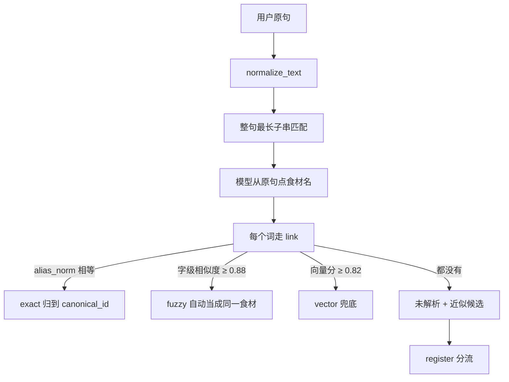

# 别名识别流程

> 对照当前代码。问答入口在 `graph/nodes.py` 的 `link_node`，链接在 `kg/normalize.py`，未收录分流在 `kg/request.py`，字级相似度在 `kg/textsim.py`。阈值默认值以 `config.py` 为准。

系统把「这是不是同一个食材的另一种叫法」分成两步：已经收录的别名直接归到同一个 `canonical_id`；没收录的词先按字面像不像已知食材，像就当疑似别名，不像才当新食材。

## 1. 别名表

权威表是 PostgreSQL 的 `dict_alias`。一行就是「这个写法属于哪个节点」。

| 字段 | 含义 |
|---|---|
| `entity_type` | 实体类型。食材是 `Ingredient`，同一张表也挂人群、症状、禁忌、营养素 |
| `canonical_id` | 归一后的节点 id |
| `alias` | 展示用的原写法 |
| `alias_norm` | 查表用的归一名 |
| `confidence` | 这条别名的置信度，子串命中时当作链接分数 |

主键是 `(entity_type, alias_norm, canonical_id)`。同一个归一名不能再挂到另一个节点上。`sync_aliases`（`kg/promote.py`）写入时会先查占用：名字已经属于别的 `canonical_id` 就跳过，避免「乌豆 / 黑大豆」变成第二个黑豆。

未确认的疑似别名不进这张表，进 `dict_alias_candidate`。唯一键是 `(entity_type, alias_norm)`，状态是 `pending` / `approved` / `rejected`。

进程内有一份全表缓存（`get_alias_store`）。改完 `dict_alias` 后要重启，或调用 `all_aliases(refresh=True)`。管理端确认候选后会刷新这份缓存。

## 2. 文本折叠

查表之前做两步，不做繁简转换。

- `normalize_text`：全角转半角（NFKC），去掉首尾和中间空白。
- `fold_alias`：拉丁字母转小写。库里是「维C」，问「维c」也能命中。整句最长匹配只在折叠后长度不变时用折叠串的下标，避免个别字符折完变长对不齐。

中文模糊不用 `pg_trgm`。实测 `similarity('黑大豆','黑豆') = 0.000`，三元组在中文短词上基本没有公共片段。`AliasStore.trigram_lookup` 只留给英文名和拼音。中文走 `kg/textsim.py` 的字级相似度：

1. 有包含关系时，分数是短词长度除以长词长度。「黑豆」对「黑大豆」是 2/3 ≈ 0.67，「黑豆」对「黑豆粥」也是 2/3。
2. 没有包含关系时，用字级编辑距离：`1 - 距离 / 较长词长度`。

## 3. 问答：已经收录的别名

`link_node` 按这个顺序认。词典只负责已经写进 `dict_alias` 的写法。

### 3.1 整句最长子串

`EntityLinker.link_question` 把别名按 `alias_norm` 长度从长到短扫原句。长的先占位，避免「凉拌黑木耳」被短的「木耳」截走一半。命中方法记为 `substring`，分数用该行的 `confidence`。同一句里同一个 `(entity_type, canonical_id)` 只留第一次。被别名占掉的位置在残余串里标成 `\x00`。

这一级是主力。旧实现拿整句去 `exact_lookup`，整句几乎永远不等于某个别名，自然语言提问会全部落空。

### 3.2 模型再点一次食材名

`kg/segment.extract_foods` 从原句抽出食材名。约束是：只要食物和食材，不要病症、功效和问法；每个名称必须是原文里的连续子串；没有就返回空列表。失败、超时、解析不出合法子串，都不把原句或残句登记成食材。

点出来的每个词再走单次链接 `EntityLinker.link`：

| 顺序 | 条件 | 方法 | 结果 |
|---|---|---|---|
| 1 | `lower(alias_norm)` 精确相等 | `exact` | 归到该节点 |
| 2 | 字级相似度 ≥ 0.88 | `fuzzy` | 自动当成同一个食材 |
| 3 | Milvus `kg_entity` 最高分 ≥ `ENTITY_LINK_THRESHOLD`（默认 0.82） | `vector` | 向量兜底 |
| 4 | 以上都没有 | — | 记为未解析，并算近似候选 |

向量检索失败（Milvus 没起、embedding 失败）返回空列表，不让整条问答链路失败。

0.88 很严。包含关系里「黑大豆 / 黑豆」只有约 0.67，问答时不会自动并进去。自动合并基本只发生在几乎一样的写法上。

### 3.3 近似候选

未解析词再做一次字级模糊，下限 `NEAR_MISS_MIN_SIM`（代码里 0.62，与下面的登记阈值一致）。每个词最多留 2 条，形如「你是不是想问黑豆」。这一步只产生建议，不写别名表。

## 4. 未收录：别名还是新食材

未解析词进 `kg.request.register`。三条出口的顺序不能反：

1. 不是食材 → 直接挡掉。
2. 疑似别名漏收 → 写 `dict_alias_candidate`，反问用户。
3. 真是新食材 → 写 `kg_ingredient_request`。

「黑大豆 / 黑豆粥」这种只是多了个字的说法，如果先按新食材登记，会给同一个东西开多条抓取任务，并埋下重复节点。

### 4.1 剥烹饪和形态

`normalize_food_term` 在查别名之前剥前后缀，得到中心词。

- 后缀：沙拉、凉拌、清炒、红烧、水煮、干煸、粥、汤、茶、汁、粉、糊、羹、膏、丝、片、块、泥、酱、末、丁、馅。
- 前缀：凉拌、清炒、红烧、水煮、干煸、炒、煮、蒸、炖、烤、炸、生。

长的先剥。剥完中心词至少还要剩 2 个字。剥完如果还夹着「配」「合适」「好处」这类强停顿词，就退回原词，避免造出「肉配」。单字虚词（好、是、多、不）不参与这道校验，否则会误伤「多宝鱼」「无花果」。

粗筛 `is_plausible_food`：长度 2–8，只含汉字或拉丁字母，并且不在营养素和泛称表里（嘌呤、热量、维生素、水果、蔬菜等）。敏感词直接拒绝，不登记、不回显。

### 4.2 分流

| 顺序 | 判断 | 动作 |
|---|---|---|
| 1 | 中心词精确命中食材别名 | `catalogued`，不建新节点 |
| 2 | 精确命中人群、禁忌、营养素、症状 | `rejected_not_ingredient`。同一词挂多种类型时按这个优先级给提示 |
| 3 | 与已知食材别名字级相似度 ≥ `FOOD_NEAR_MISS_MIN_SIM`（默认 0.62），且类型是 `Ingredient` | `alias_candidate`：写入候选表，反问「你说的可能是某某吗」 |
| 4 | 低于 0.62 | 新食材：幂等写入 `kg_ingredient_request`，同一 `food_key` 累加 `hit_count`，并排一个抓取任务 |

0.62 到 0.88 之间只建议、不自动合并。所以「黑大豆」对已有的「黑豆」（约 0.67）走疑似别名，不会另开抓取任务。

候选写入用 `ON CONFLICT (entity_type, alias_norm)`。只在 `pending` 且建议节点变了时更新 `suggested_canonical_id`。`approved` / `rejected` 是人工结论，后来的启发式不能覆盖。

## 5. 人工确认后才回流

管理端 `POST /admin/kg/alias-candidates/{id}/approve` 确认一条 `pending` 候选：

1. 敏感词扫描，命中则拒绝当别名。
2. `sync_aliases` 写入 `dict_alias`，来源 `admin_candidate`，置信度 1.0。
3. 名字已被别的节点占用 → 409 `alias_occupied`，候选状态保持原样。
4. 写上之后把对应候选标成 `approved`，并刷新别名缓存。下一问就能按新别名做最长匹配。

驳回只把候选标成 `rejected`，不写 `dict_alias`。

审核合并新食材时，`sync_aliases` 也会把该食材的别名写进同一张表，占用规则相同。
