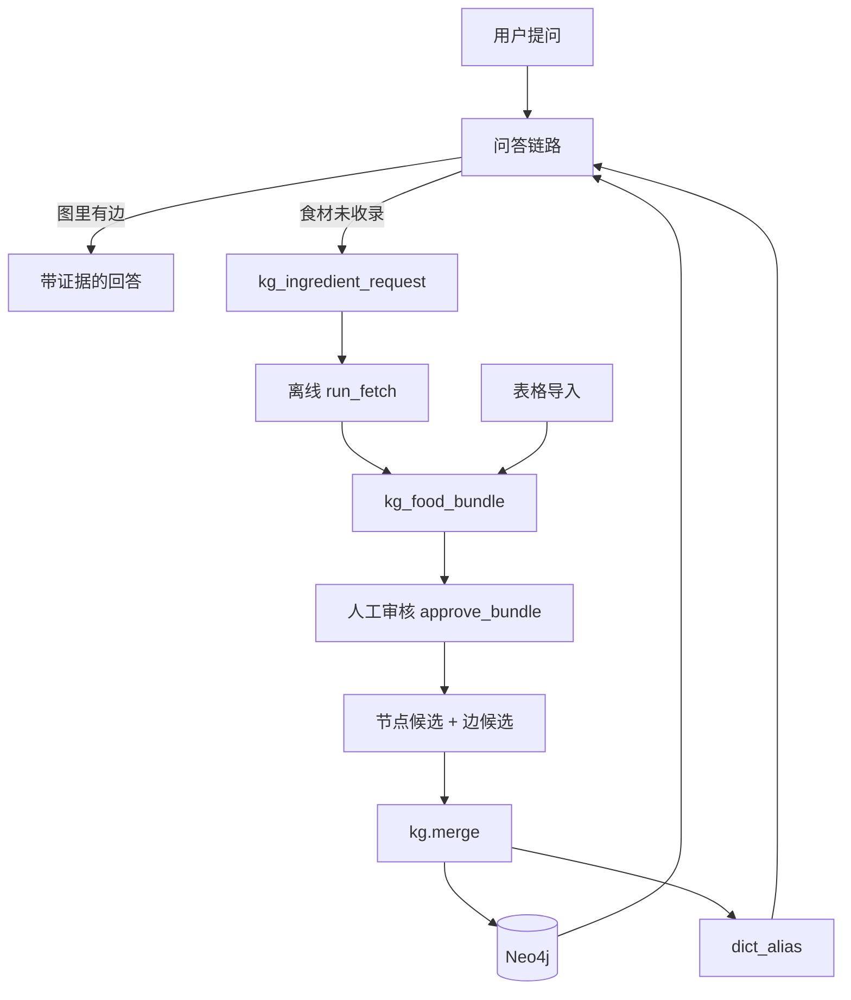
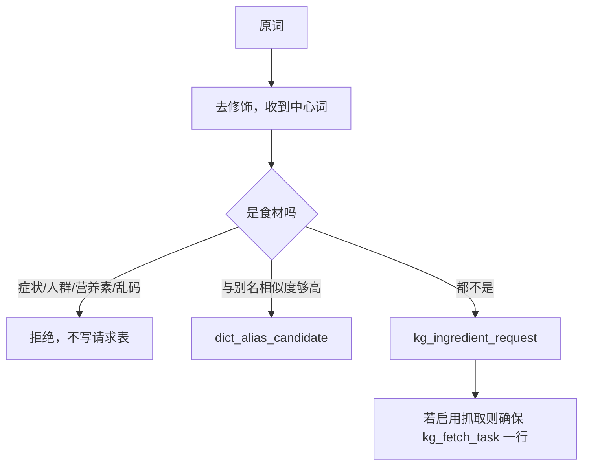
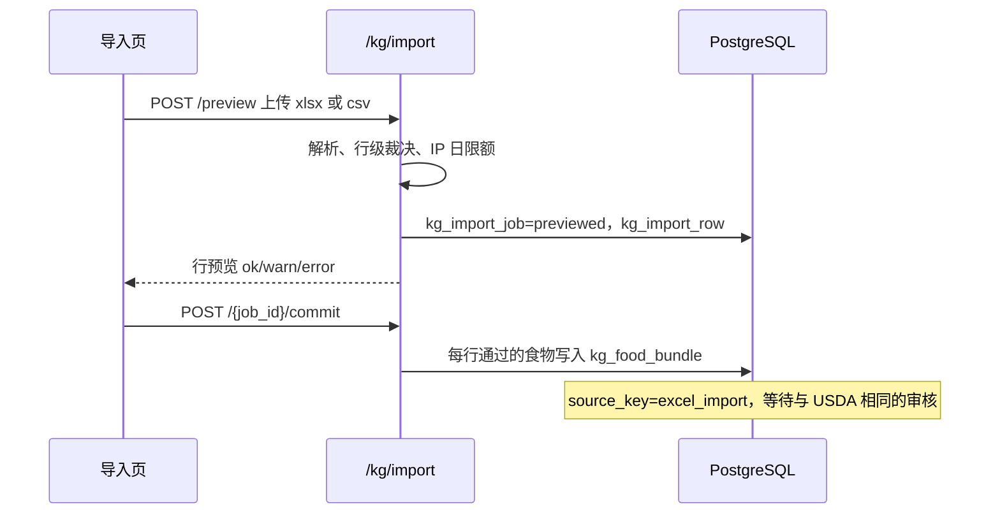
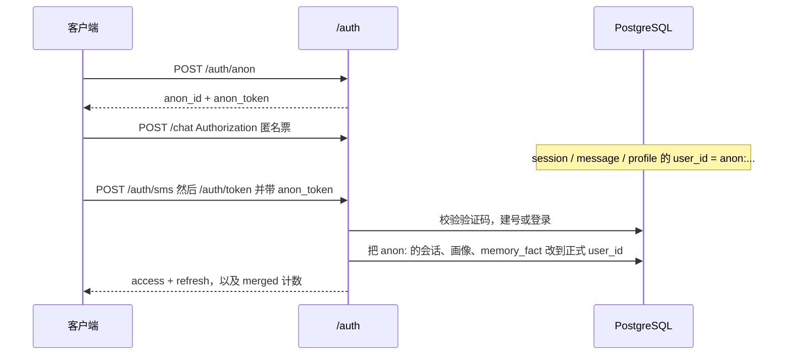

# 数据流程

> 按一次数据从进入系统到离开系统的路径来写。模块职责见 [项目架构.md](项目架构.md)，字段与阈值见 [技术细节.md](技术细节.md)。

## 1. 总览

系统里有五条彼此衔接的流。问答是在线的；抓取和合并是离线或管理端触发的。它们共享 PostgreSQL 里的登记与候选，只有合并会写 Neo4j。



## 2. 问答

`POST /chat`，body 至少要有 `question`。可选 `session_id`、`consent`。

### 2.1 进图之前

1. `get_principal` 解析 Bearer。已登录用户优先，其次是 `typ=anon` 的匿名 JWT。`AUTH_REQUIRED=false` 时才退回 body 里的 `user_id`，缺省 `anonymous`。
2. `question` 为空 → 400。
3. 带了 `session_id` 就查归属。不是这个用户的会话 → 404，LangGraph 不会启动。
4. `consent` 缺省视为允许使用画像；显式 `false` 则本轮不读不写画像。

### 2.2 LangGraph

| 步骤 | 读写 | 产出 |
|---|---|---|
| guard | 只看问句 | 命中红旗症状则直接给出就医回答，`graph_hit=false`，后面的节点不跑 |
| normalize | 无 I/O | NFKC、去空白 |
| link | 读 `dict_alias`；未命中时可能读 Milvus | `_entities`、`_unresolved`、`_near_misses`、`_link_residual` |
| route | 读 `user_profile`（记忆开启且同意时） | `_intents`、`_user_profile` |
| 分支 | — | 见下表 |
| graph_query | 读 Neo4j | `_graph_results`、`_evidence_counts`、`_graph_hit` |
| vector_fallback | 读 Milvus `kb_chunks` | 分数 ≥ 0.40 的文档块，`_degraded=true`。失败则空列表，不当成 500 |
| uncatalogued | 写登记表或别名候选 | 确定性回答，`confidence=0` |
| assemble | 无 I/O | 把事实或文档块收成上下文字符串 |
| generate | 调模型池；读最近对话 | `answer` / `basis` / `gaps` / `confidence` |
| memory_write | 写 `session` / `message`；可能异步写画像 | 返回 `session_id` |

`route_after_link`：

| 条件 | 去向 |
|---|---|
| `plan_queries` 非空（意图和节点标签对得上） | `graph_query` |
| 否则仍有 `_unresolved` | `uncatalogued` |
| 否则 | `vector_fallback` |

`route_after_graph`：有结果去 `assemble`，零结果去 `vector_fallback`。向量再失败则 `generate` 走弃答，并把「食材已收录但缺证据」和「什么都没链接上」说成两句不同的话。

### 2.3 图查询时画像怎么滤

`allergies` 与 `avoid_list` 合成 `$allergens`。搭配、不宜同食、替代三类模板排除对端食材名落在这个列表里的行。人群禁忌、营养、药物相互作用不过这道名称过滤（禁忌对象不是食材名）。

证据类型按意图从 `EVIDENCE_POLICY_MAP` 取。`INCLUDE_PROVISIONAL=false` 时单源边在 Cypher 里消失。

### 2.4 响应

`api/chat.py` 在 Langfuse 上下文里 `agent.invoke`。返回给前端的字段包括：

| 字段 | 来源 |
|---|---|
| `answer` | generate，或 guard / uncatalogued 的固定话术 |
| `basis` / `gaps` / `confidence` | 模型 JSON；弃答时 basis 为空、confidence 为 0 |
| `graph_hit` | 这次是否真有图结果 |
| `evidence_counts` | 按 A/B/C/D 计数 |
| `facts` | 图结果的表格行，没走图谱则为空 |
| `subgraph` | nodes + edges，仅图命中时有内容 |
| `food_requests` | 登记结果：`term`、`food_key`、`action`、`request_id`、`status`、`hit_count` |
| `disclaimer` | `DISCLAIMER` |
| `session_id` | 新建或沿用的会话 |
| 耗时 | 路由层计算的毫秒数 |

同一套 `answer_card` 写入 `message.meta`，历史接口回放时不用重新生成。

### 2.5 一条具体的问句

「痛风能吃海鲜吗」：

1. 最长匹配切出「痛风」（`Population` 或相关别名）和「海鲜」（`Ingredient`），具体 id 以 `dict_alias` 为准。
2. 关键词命中 `contra_population`（不能吃 / 痛风）。
3. 计划只保留锚点为 `Ingredient` 的查询，对海鲜的 `canonical_id` 跑 `CONTRA_POPULATION`。
4. 若种子边里有痛风相关禁忌，结果带 `evidence_type` / `evidence_level` / `claim_text`。
5. 组装成 `[guideline/A] 痛风患者：…` 这样的行，模型只能复述这些行。
6. 前端用 `subgraph` 画「海鲜 → 人群」而不是一段纯文本。

「菠菜和豆腐能一起吃吗」会同时命中搭配与不宜同食关键词，两个模板都跑，推荐边和相克边一起进入上下文。模型看到的等级不同，不能把 D 级民间说法说成指南。

「胸痛吃什么」在 guard 结束，不查海鲜也不查菠菜。

## 3. 未收录登记

触发点有两个：问答的 `uncatalogued` 节点（`source=chat`），以及 `POST /kg/food/request`。对比接口可以带 `source=compare`，管理端代登记为 `admin`（见 `011` 的列注释）。

`register` 内部：



幂等：`food_key` 唯一。同词再问，`hit_count += 1`，`last_requested_at` 更新，不新开抓取任务。

状态从 `queued` 开始。后续由抓取推进到 `fetching` → `fetched` → `pending_review`，审核后为 `approved` 或 `rejected`。9.1 的登记本身只写到 `queued`。

问答侧回答由登记结果的 `message` 拼接，明确「暂未收录」、不给营养数字、给出编号。一句话最多两个词，防止把整句残片全部登记进去。

`GET /kg/food/request/{id}` 给提交者看进度。

## 4. 离线抓取

命令：

```bash
python -m scripts.run_fetch --status
python -m scripts.run_fetch --limit 1
python -m scripts.run_fetch --task-id 3
python -m scripts.run_fetch --recover 15
```

单次 `process`：

1. 看当日预算。`budget_day = CURRENT_DATE` 且状态属于 running/done/failed 的任务数达到 `FOOD_FETCH_DAILY_BUDGET` 就不再 claim。
2. `UPDATE … FOR UPDATE SKIP LOCKED` 把一条 `queued` 改成 `running`，`attempts += 1`。
3. `kg.draft` 产生检索画像。`FOOD_DRAFT_MODE=auto` 时内置优先，没有再调模型；`llm` 只用模型；`static` 只用内置。
4. USDA `foods/search`，数据类型 Foundation 与 SR Legacy。
5. `choose()` 用身份词和排除词丢掉同名异物。一个都不剩则记否决原因，bundle 进人工而不是猜一条。
6. 拉 food 详情，解析营养素，每项带 `source_locator`（如 `fdc:174270#1003`）。
7. `verify()` 打分。单源上限约 0.88，状态 `pending_review`。
8. 写入或覆盖 `kg_food_bundle`（`UNIQUE(request_id)`）和 `kg_food_bundle_item`。
9. 请求状态改为待审。失败增加 `last_error`，未超过 `MAX_ATTEMPTS`（3）则稍后重试；进程崩溃留下的 `running` 靠 `--recover`。

这次调用不写 Neo4j，也不写 Milvus。

## 5. 审核到主图

管理端 `GET /admin/kg/bundles` 或命令 `python -m scripts.review_bundle`。

通过（可带 `--items` 只采用部分营养素项，`--no-merge` 只生成候选）：

1. 校验 bundle 状态，硬否决未处理时 `PromoteError`。
2. `_resolve_canonical_id`：别名表 → 已有节点候选 → 新序列号。
3. 插入或更新 `kg_node_candidate`（食材，以及营养素节点）。`aliases` 数组留给 merge 之后回流。
4. 每条采用的营养素或关系插入 `kg_candidate`，唯一键 `(batch_id, src_id, rel, dst_id)`。`batch_id` 形如 `bundle:3`。
5. `source_count < 2` 则 `provisional=true`，`evidence_level` 封顶 C。
6. bundle 与关联 request 标为 `approved`。
7. 默认接着 `merge_nodes` + `merge`。
8. merge 成功后写 `dict_alias`；非 provisional 食材嵌入 Milvus。

驳回只改 bundle 与 request 的状态和 `reject_reason`，不产生候选。

关系候选的另一条小闭环（历史抽取或手工行）是 `python -m kg.review approve` 把 `kg_candidate.status` 改成 `approved`，再 `python -m kg.merge`。`TripleExtractor` 当前没有调用方，线上新边主要来自补录翻译。

合并后的边在图里至少有：`evidence_type`、`evidence_level`、`claim_text`、`sources`（JSON 字符串）、`confidence`、`source_locator`、`source_count`、`provisional`、`batch_id`、`review_status=merged`、`relation_key`。

下一次有人问这个食材，`dict_alias` 能链上，Cypher 能按证据类型拿边。若仍是 provisional 且策略包含对应 `evidence_type`，回答会带单源提示。

## 6. 表格导入



预览超过 TTL 不能提交。`error` 行不入库。文件内重名只留首行。已有未结导入 bundle 的同一 `food_key` 走更新而不是再插一行（部分唯一索引 `uq_open_import_bundle`）。

提交之后的路径与第 5 节相同：人在管理台打开 bundle，通过后 merge。导入页不再有独立的 `demo_food` 列表作为「已经进了知识库」的证明；进主图与否看审核状态。

`GET /kg/import/foods` 与 `/jobs`、`/stats`、`/meta` 仍在 `api/food_import.py`，服务导入任务本身的查询，不代表另一套食物主数据。

## 7. 回滚

```bash
python -m kg.merge --rollback bundle:3
```

1. `MATCH ()-[r]->() WHERE r.batch_id = $bid DELETE r`
2. `MATCH (n) WHERE n.provenance CONTAINS $bid DETACH DELETE n`
3. 该批 `merged` 的边候选和节点候选改回 `pending`

第 2 步只删本批新建、且 `provenance` 写了批次号的节点。审核时挂到种子节点上的食材（例如新别名指向已有黑豆）不会被删。营养素节点故意不写 `provenance`，回滚后可能留下没有边的孤立营养素，避免把别的食材还在用的「蛋白质」删掉。

回滚不自动清理已经回流的 `dict_alias` 和 Milvus 向量。若别名已经指向被删的新 id，需要另行处理；挂到旧 id 的别名仍然有效。这是合并实现的实际行为，操作回滚后应核对别名表。

种子数据没有 `batch_id` 这套候选审计，不能用这条命令撤掉 `load_seed` 的演示边。

## 8. 登录与匿名归并



归并发生在换票的同一次请求里，避免「登录成功但海鲜过敏还留在匿名 id 上」。匿名 token 不是客户端自己编的字符串；伪造别人的 `anon:` id 换不到对方的画像。

刷新：`POST /auth/refresh` 校验哈希与过期，签发新 refresh，旧行写入 `replaced_by`。旧 refresh 再出现则按 family 吊销。登出走 `revoked_at` 且 `replaced_by` 为空。注销 `DELETE /auth/me` 会删用户行（级联 refresh、consent）并清理该 `user_id` 的记忆与画像。

## 9. 子图探索（不生成）

用户在前端点一个节点或问「这两个能不能一起吃」的图示时：

- `GET /kg/subgraph?canonical_id=&depth=` 跑邻域 Cypher，可选关系类型过滤，遵守 provisional 开关，截断到 40 节点 / 60 边。
- `GET /kg/relation` 与 `POST /kg/compare` 走 `relation_between`：直接边优先，否则最短路径（最多 3 跳，硬上限 4）。路径边打 `path=true`，和问答命中的一跳边区分开。

这两条不调用模型，也不写记忆。

## 10. 评估回放

`python -m eval.run --dataset eval/dataset.jsonl --run-chain` 对每条样本走与 `/chat` 相同的图（进程内），再按样本类别选指标。全量评估会往库里写 `eval-user` 的会话，跑完需要清理。它不推进抓取队列，也不批准 bundle。

## 11. 数据从哪来、停在哪

| 数据 | 出生 | 停留 | 进入主图的条件 |
|---|---|---|---|
| 种子食材与 40 条演示边 | `data/crosswalk`、`data/seeds` | 直接 MERGE | 初始化脚本，不经审核 |
| 别名 | crosswalk 或 merge 后回流 | `dict_alias` | 不进图，只服务于链接 |
| 用户问过但图里没有的食材 | `/chat` 或 `/kg/food/request` | `kg_ingredient_request` | 永不直接入图 |
| USDA 营养与字段 | `run_fetch` | `kg_food_bundle` + item | 人工 approve + merge |
| Excel 一行食物 | `/kg/import` commit | 同一个 bundle | 同上 |
| 会话原文 | `memory_write` | `message` | 不入图 |
| 过敏 / 忌口 | 后台抽取或资料接口 | `user_profile` | 不入图，只做过滤 |
| 实体向量 | `index_entities` 或 merge 后 | Milvus `kg_entity` | 只索引已确认且非 provisional 的 id |
