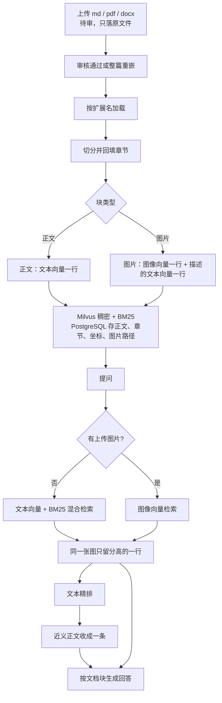

# 文档处理全链路流程

企业知识库从文件到可回答的链路：加载、切分、嵌入、检索。代码在 `kb/`。向量进集合 `kb_mm_tongyi_vision_plus_1152`（1152 维，余弦）。食疗图谱用的 `text-embedding-v3`、`kb_chunks`、`kg_entity` 不在这条链路里。

文档先上传为待审。审核通过或整篇重嵌时才解析、切分、嵌入。接口返回时，新块已经能被检索到。驳回和删除会清掉该文档的向量和块。

## 一、总流程

四段的职责：

| 段 | 做什么 | 不做什么 |
|---|---|---|
| 加载 | 把文件还原成带章节的正文块和图片块 | 不切超长正文，不写描述，不嵌向量 |
| 切分 | 长正文按语义或字符切开；问答对保持在一起；给图片补左右正文 | 不改图片字节 |
| 嵌入 | 正文嵌文本；图片先写描述，再嵌图像和描述 | 不把图和文字塞进同一次嵌入 |
| 检索 | 召回、去重、精排、近义收敛，再交给回答模型 | 评测召回停在去重，不付精排和收敛的代价 |

## 二、加载

入口是 `kb/parse.py`。扩展名决定解析器：`.md` / `.markdown`、`.pdf`、`.docx`。其他格式直接拒绝。单文件上限 32MB。

上传阶段只把原文件写到 `data/kb/{doc_id}/`，状态是待审。解析发生在通过或重嵌，避免未审核的文件占用版面模型和嵌入额度。

### 2.1 Markdown

`kb/parse_md.py` 按行扫描，不调用模型。

- `#` 到 `######` 维护标题链，写成 `一级 / 二级 / 三级`。遇到新标题先把上一段正文落成一块，所以一块正文不会跨标题。
- `` 抽成图片块。路径必须落在该 Markdown 所在目录之内，才读取字节。外链和 `data:` 不编造图片字节；没有字节的图在切分阶段改成一行文字说明。
- 图片的替代文字留在块上，后面描述模型失败或为空时可以退回这个说明。

### 2.2 Word

`kb/parse_docx.py` 用 `python-docx` 走段落，不调用模型。页码和坐标留空。

- 样式名以 `Heading` 开头的段落进入标题链，层级取样式里的数字。
- 普通段落各成一块正文，带上当时的标题链。
- 段落里的内嵌图按关系 ID 取出字节。同一部件名在一篇里只收一次。

### 2.3 PDF

`kb/parse_pdf.py` 始终用 PyMuPDF 打开文件、抽取图片字节和图片在页面上的框。框的单位是 PDF 点。正文有两条路，由 `KB_LAYOUT_BACKEND` 选择。

**字号路径（`mock`，默认）。** 不调用版面模型。每一页用 `get_text("dict")` 拿行。行内最大字号不低于该页字号中位数的 1.15 倍、且不超过 40 字，就当成标题并重置标题链。其余非空行是正文，带页码和行框。适合版式简单、或只想先把文字入库的文件。

**版面路径（`dots_mocr`，生产使用）。** 模型是私有化的 dots.mocr，OpenAI 兼容接口，地址 `KB_LAYOUT_URL`，模型名 `KB_LAYOUT_MODEL`（默认 `dots-mocr`）。每一页先按 144 DPI 渲成 PNG，再和固定提示一起发给 `/chat/completions`。

提示要求模型输出一个 JSON：每个版面元素有框、类别、文本，并按阅读顺序排列。类别限定为 Caption、Footnote、Formula、List-item、Page-footer、Page-header、Picture、Section-header、Table、Text、Title。公式用 LaTeX，表格用 HTML，其余用 Markdown，禁止翻译。温度 0.1，`max_tokens` 4096，单页超时 180 秒。

落块规则：

| 类别 | 处理 |
|---|---|
| Title、Section-header | 进入标题链，本身不单独成块。Markdown 的 `#` 前缀会剥掉 |
| Text、List-item、Caption、Footnote、Table、Formula | 成正文块 |
| Picture | 跳过。图由 PyMuPDF 抽，避免把同一张图再 OCR 一遍 |
| Page-header、Page-footer | 跳过，页眉页脚不进索引 |

模型的框是 144 DPI 下的像素。写入前乘以 `72 / 144`，换成 PDF 点，才能和 PyMuPDF 的图框比上下。JSON 解析失败时，整页退成一块正文，文字不丢。

### 2.4 图怎么插回正文

`_place_page` 不把整页按纵坐标重排。双栏若整页按 y 排序，左右栏会交织。正文保持解析器给出的阅读顺序，只把有坐标的图按 y 插到「最后一个 y 更小的正文行」后面，章节继承那一行。没有坐标的图放在页尾，坐标清空。

PDF 里这种没有坐标的图，切分时不再取左右正文。描述只带章节。Markdown 和 Word 的 `page_no` 本来就是空的，仍取左右正文。

同一尺寸的多张图，在 `get_image_rects` 拿不到 xref 时，按宽高对上版面框，从上到下各分一个坐标。

### 2.5 加载怎么提速

贵的步骤只有版面模型和后面的嵌入。加载本身把能本地做的都留在本地。

1. Markdown、Word、PDF 字号路径零模型调用。版面模型只在 `KB_LAYOUT_BACKEND=dots_mocr` 时逐页调用。
2. 版面结果里的 Picture、页眉、页脚不落块。图片字节只走 PyMuPDF 一次。
3. 切分时按图片 MD5 去重，同一篇里相同字节的图只留一张，描述和两次嵌入都只做一遍。Word 在解析时再按部件名去一次。
4. 描述限制 300 字，左右正文各截 500 字，控制视觉模型的输入和输出。
5. 嵌入的文本截到 480 字，对齐模型的文本上限，也减少请求体。
6. 稀疏向量不另调嵌入接口。Milvus 在写入时用中文分词器从 `text` 字段生成 BM25。
7. 重嵌先把新图写到 `images.new`。解析或嵌入失败就删掉暂存目录，旧向量、旧块、旧图都还在，状态保持已通过。成功后才删旧图、改名、替换向量。避免失败一次就要整篇重来。
8. 语义切分的嵌入若中途失败，立刻改用字符切分，发布不中断。长文若只想加快入库，把 `KB_SEMANTIC_CHUNK` 设为 `false`，整篇走字符切分，不再为每个句子单独嵌入。

当前嵌入是逐块串行调用，没有批接口。一张图固定两次嵌入（图像一次、描述一次）加一次描述生成。页数多的 PDF，时间主要花在逐页版面解析和逐块嵌入上。

## 三、切分

`kb/chunk.py` 的 `prepare` 接收加载结果。切分有两级，对齐「先守标题边界，再在块内找语义断点」。

### 3.1 标题级：不跨标题合并

加载阶段已经把 `heading_path` 写在每个块上。切分不把相邻标题的正文并成一块。标题为空时沿用上一块的标题，避免标题行本身被跳过后，后面的正文丢掉章节。

这一级存在，是因为检索结果要能写回「依据来自哪一节」。跨标题合并会让一节的结论沾上另一节的条件。问答文档尤其不能把下一问的答案切进上一问。

短块不会被拼成长块。PDF 的一行、Word 的一段、Markdown 里不足 480 字的一节，都原样留下。语义切分只切开超长正文，不负责把碎行合并。

### 3.2 语义级：在长正文里找断点

`KB_SEMANTIC_CHUNK` 默认开启。正文长于 `KB_CHUNK_CHARS`（默认 480）时：

1. 按句末标点（`。！？；` 及英文对应符号）和换行切成句子。不足两句就整段留下。
2. 每个句子用企业知识库的同一套文本嵌入（见第四节）得到 1152 维向量。
3. 相邻两句的余弦相似度低于 **0.55** 视为语义断点。阈值偏保守：宁可少切，也不把还在讲同一件事的句子拆开。
4. 断点之间的句子拼回一段。拼完仍达到 480 字，或已经到断点，就落成一块。

0.55 和字符上限一起用。只靠相似度，一段内部很连贯的长文会变成超过嵌入上限的一块；只靠字数，会在句子中间或话题正中切开。

语义嵌入失败、或开关关闭时，退回 `RecursiveCharacterTextSplitter`：`chunk_size=480`，`chunk_overlap=48`，长度按字符计。重叠只出现在这条退路上，语义切分本身不加重叠。

480 这个数来自嵌入模型的文本上限 1024 token。中文大约一字一个 token，480 留出余量，避免一句正文在嵌入时被接口截断后和库里存的全文对不上。

### 3.3 问答类另切

`doc_kind=qa` 不做语义切分。语义断点会把答案从问题下面劈开，检索命中问题句时看不到答案。

三种形态：

1. 行首是 `问：`、`问题1、`、`Q:`、`Q1.` 这类标记：按标记切成问答对，一对一块。
2. 没有标记，但标题叶子本身以 `？` 或 `?` 结尾：把标题补成 `问：…`，和正文放在同一块。
3. 两种都不是：退回普通切分，不猜测哪一句是问题。

一对问答超过 480 字时，只切答案。问题行复制到每一块前面，后面的块仍然带得上问的是什么。

技术类、制度类走 3.2，不走问答规则。

### 3.4 图片上下文

切分完成后再给图片补 `prev_text` / `next_text`。邻居按 `block_kind == text` 找，左右各最近的一块，各截 500 字。这时图片路径还没写，不能按路径找邻居。

PDF 上 `page_no` 有值但 `bbox` 为空的图，上下文留空。它在页尾，左右正文并不是它的说明。

没有字节的「图」改成文字块，正文用替代文字或 `图:{文件名}`，不再进入图像嵌入。

## 四、嵌入与索引

嵌入在 `kb/embed_mm.py`，写入在 `kb/publish.py` 和 `kb/milvus.py`。描述在 `kb/caption.py`。

### 4.1 模型

| 用途 | 配置 | 默认 |
|---|---|---|
| 正文、图片描述、问句、语义切分的句子 | `KB_EMBED_MODEL` / `KB_EMBED_DIM` | `tongyi-embedding-vision-plus-2026-03-06`，1152 维 |
| 图片像素 | 同一模型，内容只有图像 | 1152 维，类型必须是独立图像向量 |
| 图片描述 | `KB_CAPTION_MODEL` | `qwen3-vl-plus` |
| 关键词 | 不另选模型 | Milvus 中文分析器 + BM25 函数 |

调用 DashScope `MultiModalEmbedding`，维度参数传 1152。返回向量的 `type` 若是 `fused`，直接拒绝。这个模型在同一次 `content` 里既有文字又有图片时会返回融合向量，和纯文本向量、纯图像向量不在一个空间里，不能写进同一个字段。所以正文一次只传文字，图片一次只传图像。空文本、空图、单图超过 10MB、维度不对，都在写入前失败，并把该文档的向量和块清掉，状态回到待审（重嵌失败则保留原状态）。单图超过 5MB 只记警告，仍然入库。

集合名带模型和维度。代码发现已有集合的 `dense` 维度和 `KB_EMBED_DIM` 不一致就拒绝写入。换嵌入模型要换集合名，不能往旧集合里插另一种向量。

### 4.2 一张图两行

正文一块一行：`block_kind=text`，`dense` 是这段正文的文本向量，`image_path` 为空。

一张图两行，描述文本、图片路径、图片 MD5 相同，`chunk_id` 不同：

| 行 | `block_kind` | `dense` | 谁能命中它 |
|---|---|---|---|
| 图像行 | `image` | `embed_image_bytes` | 用户上传的图片 |
| 描述行 | `text` | `embed_text(描述)` | 用户打出来的问题、BM25 关键词 |

描述由 `qwen3-vl-plus` 生成，最长 300 字。提示分三档：前后文都有、只有一边、两边都没有。有章节时提示开头加上 `章节：…`。没有坐标的 PDF 图走第三档，只带章节。描述为空时退回 `图:{文件名}`。

这样设计，是因为文本问题和图片问题必须打到同一张图，又不能拿图像向量和文本向量互相比较。两行共用一个 `dense` 字段：文本检索走文本塔和 BM25，自然命中描述行；图片检索只走图像塔，命中图像行。描述行仍带着 `image_path`，回答里可以画出这张图。检索返回前按 `image_path` 合并，同一张图只留分数更高的那一行。

图片文件名是新的 UUID，写到文档目录的 `images/`。重嵌时字节先落在 `images.new`，库里记录的路径已经是改名后的 `images/`，改名成功就不用再改库。

### 4.3 Milvus 集合

`kb/milvus.py` 用显式 schema，关闭动态字段。主键 `id` 自增。业务主键是 `chunk_id`。

| 字段 | 类型 | 索引 |
|---|---|---|
| `chunk_id`、`doc_id`、`tenant_id`、`block_kind` | 变长字符串 | 无。删除按 `doc_id` 过滤，检索按 `tenant_id` 过滤 |
| `text` | 变长字符串，上限 4096 **字节**，开启中文分析器 | 分析器喂给 BM25 |
| `heading_path` | 变长字符串，512 字节 | 无。章节不参与检索，只带回给回答和展示 |
| `image_path` | 变长字符串，512 字节 | 无。去重在应用层按返回结果做 |
| `dense` | 1152 维浮点向量 | `AUTOINDEX`，度量 `COSINE` |
| `sparse` | 稀疏向量 | `SPARSE_INVERTED_INDEX`，度量 `BM25`。由函数 `text_bm25` 从 `text` 生成，插入时不传这个字段 |

变长字段按字节截断。中文一字段切 4000 个字仍可能超过 4096 字节，所以截的是 UTF-8 字节而不是字符数。空正文写成 `图`，避免分析器和嵌入收到空串。

`dense` 用 `AUTOINDEX`：企业文档的块数量是千级，用默认索引即可，不再手调 HNSW 的 `M` 和 `efConstruction`。度量用余弦，和这个嵌入模型的相似度定义一致。建索引的度量和检索时的 `metric_type` 都是 `COSINE`。

`sparse` 用倒排而不是再训一个稀疏模型。制度、命令、配置项里大量专有名词，稠密向量会把它们抹进语义里；BM25 把原词留在倒排里。中文分析器负责分词。混合检索用 `WeightedRanker(1.0, 1.0)`，稠密和稀疏权重相同：专有名词和语义改写都有机会排到前面，不把其中一路压成微调。

PostgreSQL 的 `kb_chunk` 存块的正文、页码、框、章节、图片路径和 MD5，不存向量。页面展示和重嵌对账读这里；相似度只问 Milvus。

## 五、检索

问答图在 `kb/workflow.py`：检索 → 记下图像块 → 生成。近期对话只放进生成提示，用来理解「它」「上一条」，不改写检索词，也不进向量库。

### 5.1 两条检索

**文本问题**（`search_question`）：问题用 `embed_text` 得到 1152 维向量，和原文一起做混合检索。稠密路检索 `dense`，稀疏路把原文交给 BM25。两边都带 `tenant_id == 当前租户`，租户之间不串结果。没有租户或问题为空，直接不查。

**图片问题**（`search_picture`）：只把图片字节嵌成图像向量，在 `dense` 上做向量检索，同样按租户过滤。不走 BM25，也不再嵌一次文本。集合里只有一个 `dense` 字段，原始命中里可能夹着正文行；同一张图的描述行和图像行接着按路径合并，图像向量和图像行同属图像塔，通常留下图像行。

评测召回调用的也是这两个函数，所以评测和线上的去重规则一致。

### 5.2 多取再合并

一张图占两行，混合检索的前几名里经常是同一张图的图像行和描述行。`milvus._fetch` 把请求条数放大为 `max(limit × 2, 20)`，去重后再截回调用方要的条数。放大写在 Milvus 查询里，不把混合检索的 `limit` 固定成 20。

`_dedupe` 按 `image_path` 分组，保留分数更高的那条，位置用先出现的那一次。没有图片路径的正文不合并。描述行分数更高时留下的仍是 `block_kind=text`，但带着 `image_path`，回答里一样能出图。

### 5.3 文本问题的召回池

文本提问的 `limit` 固定为 `max(KB_RERANK_CANDIDATES, KB_SEARCH_LIMIT)`，默认 `max(20, 6) = 20`。精排开关只决定要不要调用精排接口，不决定召回多少条。这样精排关掉时，近义收敛仍然看得到大约 20 条，而不是只在前 6 条里收。

图片提问的 `limit` 就是 `KB_SEARCH_LIMIT`（默认 6），没有精排，也没有近义收敛。

### 5.4 精排

只对文本问题，并且 `KB_RERANK_ENABLED`、密钥、`RERANK_MODEL_POOL` 都在时才调用。模型取池子的第一个，默认 `qwen3.7-text-rerank`。地址是 DashScope 原生 text-rerank（`RERANK_BASE_URL`），不是兼容模式的 `/rerank`。

每条候选截前 500 字送给模型（空文本用 `图`）。`top_n` 等于候选条数，精排只重排，不在这里截成 6 条。返回的 `relevance_score` 写回该条的 `score`。这个分不是余弦，不能和文档块阈值比较。模型没返回的下标按原混合检索顺序接在后面，原分数保留。

超时写死 3 秒，不重试。没密钥、池是空的、超时、非 200、结果为空、一个合法下标都没有，都退回混合检索的整表。工作流里精排抛错同样退回整表。精排调用记一条 0 token 的 `kb_rerank` span，不记入费用账本。

精排放在 `search_question` 外面。离线评测要的是召回，不承担这 3 秒，也不会因为精排失败改变召回集合。

### 5.5 近义收敛

精排之后、生成之前，`kb/diversify.py` 按当前顺序扫描。和已经留下的某一条「字面几乎相同」就丢掉后面这条，直到凑满 `KB_SEARCH_LIMIT`。凑不满就少返回，不把丢掉的近义条补回来。`KB_DIVERSIFY_ENABLED=false` 时，这里只做唯一一次截断：取排序后的前 6 条。

相近的判定：

1. 全文先做 NFKC（全角数字、字母折成半角），再去掉全部空白。空文本当成 `图`。比较的是全文，不用精排的那 500 字窗口。
2. 切成相邻二字的集合。短于 2 字的文本自成一个元素，不会因为太短就和长文得高分。
3. 重叠分是 `|交集| / sqrt(|A| × |B|)`。默认 **0.72**（`KB_DIVERSIFY_THRESHOLD`）以上视为同一条。抄写、只差换行或空格的段落会收成一条；换了说法、共同字很少的段落会都留下。
4. 再用正则抽出整数和小数，排序后必须完全相同才允许合并。「每人每天 100 元」和「每人每天 120 元」重叠分可以超过 0.72，数字不同，两条都留。
5. 不看 `heading_path`。同一章里内容不同的块仍然是多条。

图片行的正文是视觉模型写的描述，同样参加这次比较。同一路径的两行已经在 5.2 合并过。两张不同的图如果描述很像，会收成一条，留下的那条仍带着自己的图。

收敛是本地计算，不再请求模型。异常时退回排序后的前 6 条，避免一次坏数据让整次提问失败。span 名 `kb_diversify`，同样是 0 token。

字面重叠用来对付「同一段被召回多次」。它不覆盖「意思一样、用词差很多」的改写。换语义模型做两两去重，会把话题相近但内容不同的段落也收掉，和「同章不同内容要留下」冲突，所以没有接在精排后面。

### 5.6 生成

收敛后的块（图片问题则是去重后的最多 6 条）交给 `LLM_MODEL_POOL` 里的对话模型，`enable_thinking` 关闭。提示要求只根据这些块回答，块里没有的内容回答「这批制度里没有这段」。每条块格式是 `[章节路径] 正文`，和离线评估看到的依据相同。没有命中任何块时直接弃答，不调用模型。

图像块的 id 记在 `kb_image` span 里，供追踪。真正把图插进回答条目，是前台按章节路径和条目对齐，不在这条生成链路里改写 Markdown。

### 5.7 检索侧的优化对照

| 点 | 做法 | 原因 |
|---|---|---|
| 混合检索 | 余弦 + BM25，权重 1:1 | 语义改写和专有名词各有一路 |
| 租户下推 | 两条检索的过滤都是 `tenant_id` | 不把别的租户的块取回再丢 |
| 放大召回 | `max(limit×2, 20)` | 一图两行会占掉名额，去重后仍够条数 |
| 路径去重 | 按 `image_path` 留高分 | 图像行和描述行不要同时进回答 |
| 文本多召回 | 始终取 20 再精排、再收敛 | 精排和收敛需要候选；截断只发生在收敛 |
| 精排外置 | 不放进 `search_question` | 评测召回不付精排超时 |
| 精排不截断 | `top_n` 为全量，漏返回的名次按原序补上 | 截断交给收敛，部分结果不丢候选 |
| 精排失败 | 3 秒、不重试、退回原顺序 | 精排挂了仍能回答 |
| 近义收敛 | 二字重叠 + 数字多重集，本地算 | 去掉抄写重复，又保住金额不同的制度条款 |
| 图片问题短路 | 只做图像检索和路径去重 | 图像向量和文本精排不是同一套分 |
| 对话不参与检索 | 历史只进生成提示 | 指代消解不污染向量查询 |
