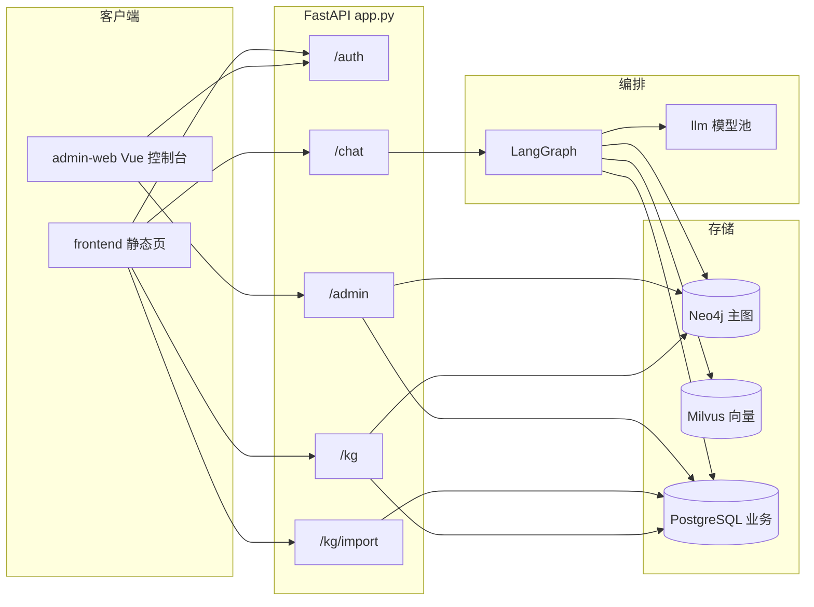
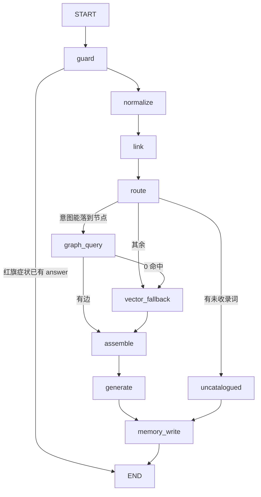

# 项目架构

> 食疗养生助手 `nutri_graph`。用一张带证据等级的知识图谱约束大模型：民间「不宜同食」和有出处的医学禁忌在图里是不同的边，回答只引用检索到的事实。
>
> 本文描述仓库当前代码的运行时结构。配套文档：
>
> | 文档 | 内容 |
> |---|---|
> | [技术细节.md](技术细节.md) | 证据模型、检索、生成、身份、模型池、评估 |
> | [数据流程.md](数据流程.md) | 问答、登记、抓取、审核入图、导入、回滚 |
> | [neo4j建表细节.md](neo4j建表细节.md) | 节点、关系、约束、幂等 MERGE |
> | [milvus索引细节.md](milvus索引细节.md) | 两个集合、向量索引、阈值与写入边界 |
> | [项目亮点.md](项目亮点.md) | 和普通 RAG 不一样的设计选择 |

技术栈：LangChain / LangGraph / FastAPI / Neo4j 5 / Milvus 2.4 / PostgreSQL 16（pgvector）/ DashScope / Langfuse / Ragas。

## 1. 一句话分层

请求从 FastAPI 进来，问答走 LangGraph。图事实在 Neo4j，口语到节点的别名在 PostgreSQL，向量兜底在 Milvus。写主图只有 `kg.merge` 一个入口：抓取和表格导入都先落 PostgreSQL 候选，人工通过后才 MERGE。



## 2. 进程与目录

服务入口是 `app.py`：配日志、挂路由、启动时打印鉴权与短信通道状态。业务不写在入口里。

```
nutri_graph/
├── app.py                 FastAPI 装配
├── config.py              环境变量集中读取
├── api/                   HTTP 路由（一个域一个文件）
├── graph/                 LangGraph：state / nodes / workflow / boundary
├── kg/                    图谱域：模型、查询、归一、抓取、审核、合并
├── rag/                   Milvus 客户端 + DashScope embedding
├── llm/                   模型池、中间件、调用入口
├── memory/                短期会话、用户画像、匿名归并
├── security/              短信、频控、令牌、手机号加密、图形验证码
├── observability/         Langfuse trace
├── eval/                  Ragas 分层评估
├── migrations/            001–013，PostgreSQL 结构的唯一来源
├── scripts/               迁移、种子、抓取、审核、实体索引
├── frontend/              无构建步骤的问答页与导入页
├── admin-web/             Vue 3 + Element Plus 管理台
├── data/                  crosswalk 别名、种子边
└── docs/
```

`graph/` 只负责「这一问怎么走」。`kg/` 负责图长什么样、怎么查、怎么写。两边通过 `kg.query.GraphQuery` 和 `kg.normalize.EntityLinker` 交接。

## 3. 运行时组件

本地依赖由 `docker-compose.yml` 拉起：

| 组件 | 镜像 | 端口 | 职责 |
|---|---|---|---|
| Neo4j 5.26 | `neo4j:5.26-community` | 7474 / 7687 | 食疗主图 |
| Milvus 2.4.17 | `milvusdb/milvus:v2.4.17` | 19530 / 9091 | 实体向量、文档块向量 |
| etcd + MinIO | Milvus 依赖 | 9000 / 9001 | Milvus 元数据与对象存储 |
| PostgreSQL 16 | `pgvector/pgvector:pg16` | 5432 | 账号、候选、记忆、审核队列 |
| Langfuse 3 | `langfuse/langfuse:3` | 3000 | 问答 trace（另带独立 ClickHouse 与 Postgres） |

应用默认监听 `0.0.0.0:8810`（`HOST` / `PORT`）。生产用 `deploy/` 里的 systemd 与 nginx：静态页直出，API 反代到 uvicorn。

初始化顺序：

1. `python -m scripts.migrate` — 按文件名顺序执行 `migrations/*.sql`，已应用的记在库里，可重复跑。
2. `python -m kg.constraints` — Neo4j 唯一约束与属性索引。
3. `python -m scripts.load_crosswalk` — 别名写入 `dict_alias`。
4. `python -m scripts.load_seed` — 演示节点与边 MERGE 进 Neo4j。
5. `python -m scripts.index_entities` — 把 `dict_alias` 里的实体嵌入 Milvus `kg_entity`。这一步不做的话，实体链接的向量级是空的。

`003_memory_vector.sql` 要 `CREATE EXTENSION vector`。pgvector 未标 trusted，非超级用户会失败；失败只影响 `memory_fact`，前面的业务表已经提交。

## 4. 四个存储各管什么

| 存储 | 放什么 | 不放什么 |
|---|---|---|
| Neo4j | 已审核的节点和边，带证据四件套与 `batch_id` | 待审候选、用户账号、会话原文 |
| PostgreSQL | 别名、候选、抓取产物、会话、画像、令牌、导入批次 | 主图的遍历查询 |
| Milvus | 已收录实体的别名向量；文档块降级检索 | provisional 单源节点、未审核数据 |
| pgvector | `memory_fact.embedding`（1024 维） | 当前问答链路不读这张表 |

主图和向量库故意分开：Cypher 能按证据类型过滤、按用户过敏排除；向量只做「这句话像哪个节点」和「图没命中时有没有相关文档」。

## 5. HTTP 面

路由在 `app.py` 里按这个顺序挂上：`auth`、`admin`、`chat`、`history`、`kg`、`food_import`、`health`、`system`。

| 前缀 | 模块 | 鉴权 | 作用 |
|---|---|---|---|
| `/auth` | `api/auth.py` | 发码与换票公开；`/me` 要 access token | 短信登录、刷新、登出、注销、匿名身份、图形验证码 |
| `/chat` | `api/chat.py` | `AUTH_REQUIRED=true` 时必须是登录用户或服务端签发的匿名 JWT | 主问答 |
| `/sessions`、`/recent-questions` | `api/history.py` | 同聊天身份 | 历史会话与最近问法 |
| `/kg` | `api/kg.py` | 登记可匿名；子图查询跟随业务身份策略 | 未收录登记、邻域、两食材关系、对比 |
| `/kg/import` | `api/food_import.py` | 不登录。靠 IP 日限额、文件大小、预览 TTL | Excel / CSV 预览后提交进审核队列 |
| `/admin` | `api/admin.py` | 整个 router `require_admin` | 概览、关系候选、补录 bundle、登记、别名候选 |
| `/health` | `api/health.py` | 公开 | Neo4j / Milvus / PostgreSQL / 配置探活 |
| `/llm/pool` | `api/system.py` | 公开运行时视图 | 当前模型、移出池、冷却 |

`AUTH_REQUIRED=true` 之后，`/chat` 不再接受前端自己传的 `user_id`。匿名身份必须是 `POST /auth/anon` 签发的 JWT（`typ=anon`，`sub` 以 `anon:` 开头）。

## 6. 问答编排

`graph/workflow.py` 把节点编成一张图，进程内编译一次（`get_agent()`）。



未收录分支不进 `generate`：没有图事实时不让模型自由发挥，话术由 `kg.request.register` 的登记结果拼出来。

红旗症状（胸痛、呕血、意识模糊等，`RED_FLAG_SYMPTOMS`）在 `guard` 短路，不查图、不调模型。

## 7. 图谱域模块

| 模块 | 职责 |
|---|---|
| `kg/schema.py` | 五类节点、七类关系、证据枚举、`relation_key`、`sources` 序列化 |
| `kg/constraints.py` | Neo4j 唯一约束与索引，幂等 |
| `kg/normalize.py` | 文本归一、`dict_alias`、整句最长匹配、模糊、向量兜底 |
| `kg/textsim.py` | 中文字级相似度（pg_trgm 对中文不可用） |
| `kg/query.py` | 意图关键词、锚点标签、按意图的 Cypher |
| `kg/subgraph.py` | 查询行翻译成前端 nodes/edges；邻域与最短路径 |
| `kg/request.py` | 未收录三出口：挡掉 / 疑似别名 / 新食材登记 |
| `kg/draft.py` | 检索画像（身份关键词、排除词） |
| `kg/usda.py` | USDA FoodData Central 客户端 |
| `kg/fetch.py` | 离线抓取流水线，`FOR UPDATE SKIP LOCKED` 领任务 |
| `kg/verify.py` | 四维规则打分，不让模型自评 |
| `kg/nutrients.py` | 营养素字段到图节点的映射 |
| `kg/promote.py` | bundle 翻译成节点候选和边候选，通过后调 merge |
| `kg/merge.py` | 主图唯一写入口，按 `batch_id` 回滚 |
| `kg/review.py` | 关系候选的列表 / 批准 / 驳回 |
| `kg/import_bundle.py` | 表格导入写入 `kg_food_bundle` |
| `kg/importer.py` | 模板解析与行级校验 |
| `kg/extract.py` | `TripleExtractor` 仍在，当前没有调用方 |

## 8. 两个前端

**问答站 `frontend/`**：`index.html` + `assets/app.js`，另有 `import.html` 做表格导入。没有打包步骤，nginx 直接吐静态文件。问答结果消费 `/chat` 返回的 `answer`、`basis`、`evidence_counts`、`graph_hit`、`facts`、`subgraph`、`food_requests`。

**管理台 `admin-web/`**：Vue 3、Vue Router、Element Plus、Vite。页面覆盖登录、概览、关系候选、补录列表与详情、未收录登记、别名候选。所有数据走 `/admin`，角色不是 `admin` 进不去。

导入页和审核页看到的是同一条队列：`013_import_bundle.sql` 去掉了独立的 `demo_food`，表格行写入 `kg_food_bundle`（`source_key=excel_import`），和 USDA 抓取共用审核与合并。

## 9. 身份在架构里的位置

`security/` 不参与图谱逻辑，只在 API 边界产生 `user_id`：

- 手机号三态：`phone_hash`（HMAC，唯一）、`phone_enc`（Fernet）、`phone_mask`（展示）。
- access token 短寿命 JWT；refresh token 只存哈希，旋转，重放整族吊销。
- 短信 `console`（本地日志）或 `dypns`（阿里云号码认证，验证码由平台托管）。
- 图形验证码在同一出口 IP 免费次数用完后强制，挡住换号轰炸。

登录时若带上匿名 token，`memory/anonymous_merge.py` 把该 `anon:` 用户的会话、画像、`memory_fact` 改挂到正式 `user_id`。

## 10. 可观测与评估（旁路）

- 线上：`observability/tracing.py` 给每次 `/chat` 建 Langfuse trace，metadata 带 `graph_hit`、`evidence_counts`、是否降级。Langfuse 没配 key 或关掉开关时，上下文管理器直接 yield `None`，问答照常。
- 离线：`eval/run.py` 对 75 条评估集分三类打分。有据样本走 Ragas；弃答和未收录走确定性规则。评估不在请求路径上。

## 11. 当前边界（读代码时容易误判的几处）

这些是架构现状，不是待排期的口号：

- 主图写入只经过 `kg.merge`。种子装载 `scripts/load_seed.py` 是初始化例外，用同一套 `canonical_id` + `relation_key` MERGE，不经过候选表。
- `memory_fact` 的表和读写函数在，问答生成不召回它。长期约束实际生效的是 `user_profile` 的过敏与忌口，在 Cypher 里 `NOT b.canonical_name IN $allergens`。
- 实体链接的第四级「LLM 消歧」在 `EntityLinker` 构造参数里留了 `llm`，`link()` 没有调用它。
- 工作流注释写明：在线断言级接地还没做，所以没有空的 verify 节点。
